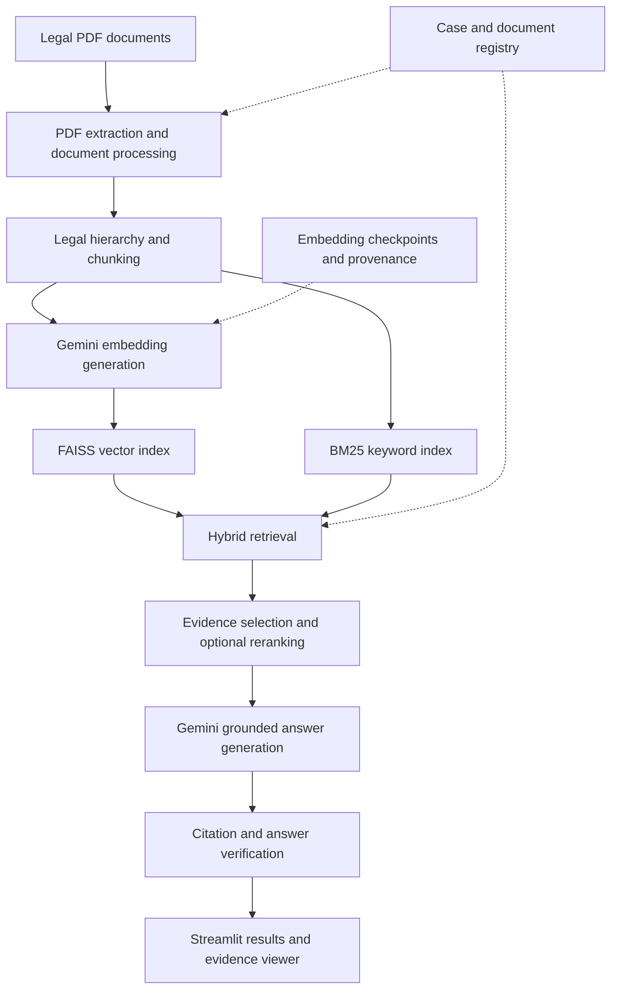

# Legal Document Intelligence

**Evidence-grounded legal document analysis using hybrid retrieval-augmented generation (RAG), document-aware citations, and automated answer verification.**

[](https://www.python.org/)
[](https://streamlit.io/)
[](#testing)
[](#limitations)

**Live application:** https://legal-document-intelligence-demo.streamlit.app/

> **Research prototype:** This system supports document exploration and evidence retrieval. It is not a substitute for professional legal advice. Live processing depends on Gemini API availability and quota.

---

## 1. Overview

Legal documents are often lengthy, highly structured, and difficult to search using conventional keyword matching alone.

Legal Document Intelligence is a Python-based application designed to extract, organize, retrieve, and analyze evidence from legal PDF documents.

The system combines:

- Legal-structure-aware document processing
- Semantic and lexical retrieval
- Evidence-grounded language model generation
- Citation integrity checks
- Multi-document case management
- Recoverable embedding workflows
- An interactive Streamlit interface

The objective is to improve the traceability of AI-assisted legal document analysis by linking generated responses to retrieved source evidence.

## 2. Key Features

### Document ingestion and processing

- PDF text extraction using PyMuPDF
- Legal hierarchy and paragraph detection
- Structured document chunking
- Document identity and metadata propagation
- PDF table extraction and validation
- Scanned-page detection and OCR support

### Retrieval

- Gemini embedding generation
- FAISS semantic vector search
- BM25 keyword search
- Hybrid retrieval using Reciprocal Rank Fusion
- Optional reranking
- Multi-document retrieval within case workspaces

### Answer generation and verification

- Evidence-grounded answer generation
- Structured answer output
- Source references and citations
- Deterministic citation integrity validation
- LLM-assisted answer verification
- Evidence coverage and legal reasoning analysis
- Abstention mechanisms for insufficient evidence

### Reliability and user interface

- Streamlit-based application
- Document and case registries
- Incremental embedding checkpoints
- Checkpoint validation and provenance tracking
- Resume support for interrupted document processing
- Live embedding progress indicators
- Bounded handling of excessive Gemini embedding retry delays
- Per-document processing locks

## 3. System Architecture



The diagram is a high-level representation. Individual processing and retrieval branches depend on document type, application state, and configured options.

## 4. Technology Stack

| Layer | Technology |
|---|---|
| Programming language | Python 3.11 |
| Web application | Streamlit |
| PDF processing | PyMuPDF |
| OCR dependency | Tesseract OCR |
| Embedding model | `gemini-embedding-001` |
| Vector retrieval | FAISS |
| Keyword retrieval | BM25 (`rank-bm25`) |
| Hybrid fusion | Reciprocal Rank Fusion |
| Language model integration | Google GenAI SDK |
| Reranking support | Sentence Transformers |
| Numerical processing | NumPy |
| Automated testing | pytest |

## 5. Repository Structure

```text
legal-document-intelligence/
├── app.py
├── src/
│   ├── extraction.py
│   ├── chunking.py
│   ├── embeddings.py
│   ├── document_embedding.py
│   ├── document_pipeline.py
│   ├── document_registry.py
│   ├── case_management.py
│   ├── retrieval.py
│   ├── bm25_retrieval.py
│   ├── hybrid_retrieval.py
│   ├── multi_document_retrieval.py
│   ├── generation.py
│   ├── verification.py
│   ├── legal_reasoning.py
│   └── ...
├── tests/
├── data/
│   └── evaluation/
├── requirements.txt
├── packages.txt
├── .python-version
└── README.md
```

Additional modules provide table processing, provenance validation, document locking, citation viewing, and Streamlit UI components.

## 6. Installation

### Requirements

- Python 3.11
- pip
- Gemini API access
- Tesseract OCR for OCR-dependent workflows

### Clone the repository

```bash
git clone https://github.com/vinnyyxd/legal-document-intelligence.git
cd legal-document-intelligence
```

### Create a virtual environment

```bash
python -m venv .venv
```

Activate it on Linux/macOS:

```bash
source .venv/bin/activate
```

Or on Windows:

```powershell
.venv\Scripts\Activate.ps1
```

### Install Python dependencies

```bash
pip install -r requirements.txt
```

Install Tesseract OCR separately if needed for scanned documents.

### Configure API credentials

The application requires a Gemini API key for model-dependent operations.

For Streamlit deployments, configure credentials through the platform's secret management interface.

Use the secret name expected by the application configuration.

Never commit real API keys, passwords, or private credentials to Git.

### Start the application

```bash
streamlit run app.py
```

## 7. Application Workflow

1. Open the Streamlit application.
2. Authenticate if demo access protection is enabled.
3. Create or select a legal case workspace.
4. Upload a supported PDF document.
5. Extract and process the document.
6. Generate embeddings and build retrieval indexes.
7. Ask a question about the available evidence.
8. Review the generated answer, source references, and verification information.

Embedding generation may require multiple API requests.

The application supports checkpoint-based recovery when valid checkpoints remain available.

## 8. Retrieval Evaluation

An initial retrieval benchmark was developed using the original GDPR PDF.

### Benchmark configuration

| Property | Value |
|---|---|
| Document | General Data Protection Regulation (GDPR) |
| Extracted pages | 88 |
| Legal chunks | 397 |
| Benchmark questions | 20 |
| Answerable retrieval questions | 16 |
| Out-of-scope questions | 4 |
| Evaluation cutoff | K=5 |

### Results

| Metric | BM25 | Hybrid FAISS + BM25 |
|---|---:|---:|
| Hit@5 | 0.7500 | **1.0000** |
| Recall@5 | 0.7500 | **1.0000** |
| MRR@5 | 0.5073 | **0.7917** |

Hybrid retrieval returned the expected chunk within the top five results for all 16 answerable benchmark questions.

Four questions missed by BM25 at K=5 were recovered by the hybrid pipeline.

Each answerable question has one provisional expected relevant chunk, so Hit@5 and Recall@5 are numerically identical.

**Important:** These are preliminary retrieval results from a small, manually designed benchmark. They do not establish general legal-answer accuracy, citation correctness, or model reliability across legal domains.

See [GDPR Evaluation Documentation](data/evaluation/README.md) for methodology and limitations.

## 9. Testing

The repository contains automated tests covering major reliability and integration behaviors, including:

- GDPR baseline preservation
- Document identity propagation
- Citation integrity
- Generation and verification integration
- Retrieval reliability
- Ingestion and checkpoint recovery
- Embedding progress callbacks
- Streamlit integration checks
- Gemini embedding retry safeguards

At the latest validated development checkpoint:

**87 automated tests passed**, with one non-failing PyMuPDF deprecation warning.

Run the test suite:

```bash
python -m pytest -q
```

Tests cover selected behaviors and do not constitute a comprehensive security, legal-accuracy, or live deployment certification.

## 10. Reliability and Recovery

The document processing pipeline includes:

- Atomic embedding checkpoint writes
- Embedding model and dimension validation
- Chunk identity and fingerprint validation
- Reuse of compatible saved embeddings
- Per-document processing locks
- Progress reporting for embedding batches
- Retry handling for temporary API failures

If Gemini requests an excessively long embedding retry delay, the application stops processing rather than waiting for hours.

Saved checkpoints are reusable only when the corresponding checkpoint files remain available and valid.

## 11. Limitations

This project is a research and demonstration prototype.

Current limitations include:

- Dependence on Gemini API availability and quota
- Potential loss of locally stored application data on ephemeral cloud hosting
- Limited evaluation coverage beyond the initial GDPR benchmark
- Provisional benchmark labels
- No comprehensive legal-answer accuracy evaluation
- No formal citation correctness benchmark
- No measured end-to-end retrieval latency benchmark
- Potential OCR and table extraction errors on difficult PDF layouts
- Demo-oriented authentication rather than production-grade identity management
- Synchronous operations that may block during API retries or processing

Generated outputs should be reviewed against their cited legal sources.

## 12. Future Development

Potential future improvements include:

1. **Persistent cloud storage:** Durable document, case, checkpoint, and index storage.
2. **Asynchronous processing:** Background ingestion jobs and non-blocking progress tracking.
3. **Expanded evaluation:** Multi-domain legal datasets, citation accuracy, answer grounding, and abstention metrics.
4. **API resilience:** Better quota monitoring, structured error handling, and operational alerts.
5. **Production security:** Stronger authentication, authorization, and access controls.
6. **Code maintainability:** Selective refactoring of large functions and improved exception handling.
7. **Deployment observability:** Structured logging, health checks, and performance monitoring.

These are planned enhancements, not claims of currently implemented functionality.

## 13. Responsible Use

This application is intended for educational, research, and document-analysis purposes.

It does not provide authoritative legal advice.

Users should verify cited evidence and consult qualified legal professionals for consequential legal decisions.

---

**Project:** Legal Document Intelligence
**Category:** Applied AI / Natural Language Processing / Retrieval-Augmented Generation
**Implementation:** Python, Streamlit, Gemini, FAISS, BM25
