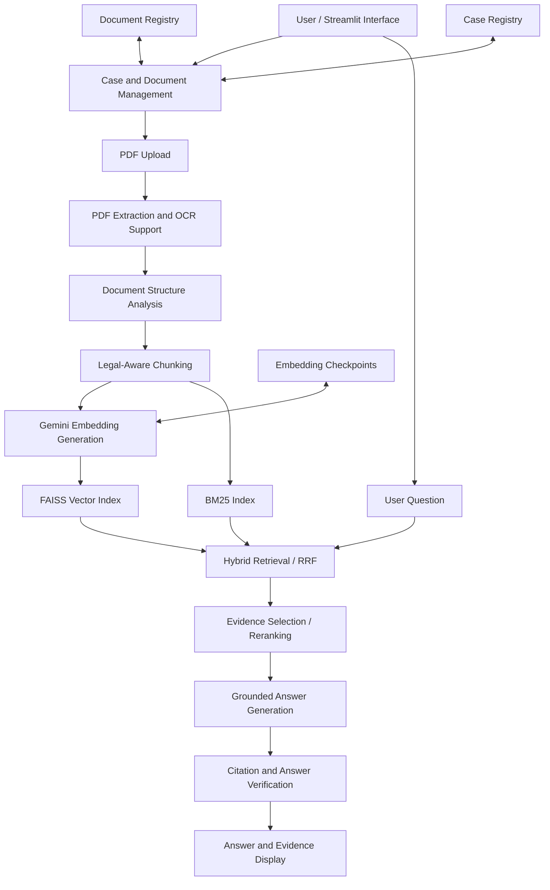

# System Architecture

## Legal Document Intelligence

Legal Document Intelligence is a Python-based legal document analysis application built around a hybrid Retrieval-Augmented Generation (RAG) architecture.

The system processes legal PDF documents, constructs searchable representations, retrieves relevant evidence, and generates answers supported by source citations.

This document describes the application's principal components, data flow, reliability mechanisms, and architectural limitations.

---

## 1. High-Level Architecture

This diagram is conceptual. Some processing stages and optional components may vary depending on document characteristics and application configuration.

## 2. Application Layer

**Primary entry point:** `app.py`

The application uses Streamlit to provide an interactive interface for legal document processing and analysis.

Supporting interface modules include:

- `workspace_ui.py` — workspace dashboard
- `result_ui.py` — result presentation
- `citation_viewer.py` — PDF citation visualization
- `legal_reasoning_ui.py` — legal reasoning exploration
- `embedding_progress_ui.py` — embedding progress updates
- `demo_auth.py` — demonstration access control

The interface connects user actions to the underlying document and retrieval pipelines.

## 3. Document Ingestion

Relevant modules:

- `extraction.py`
- `document_structure.py`
- `chunking.py`
- `table_extraction.py`
- `document_processing.py`
- `document_pipeline.py`

### Processing flow

1. Accept a PDF document.
2. Extract text and page metadata.
3. Identify document structure where possible.
4. Detect legal sections, articles, and paragraphs.
5. Create structured retrieval chunks.
6. Preserve document identity and source references.
7. Prepare extracted content for indexing.

The application also includes scanned-page detection, OCR support, and table extraction utilities.

Extraction quality depends on the structure and quality of the input PDF.

## 4. Document Identity and Case Management

Relevant modules:

- `document_registry.py`
- `case_management.py`
- `multi_document_retrieval.py`

Document identity is maintained separately from the original filename.

This helps distinguish documents that may share a filename and supports evidence attribution across multiple uploaded documents.

The document registry maintains document-related metadata and processing state.

The case registry groups documents into case-oriented workspaces.

Multi-document retrieval can search evidence associated with the relevant document collection.

## 5. Embedding Generation

Relevant modules:

- `embeddings.py`
- `document_embedding.py`
- `embedding_provenance.py`

The embedding pipeline converts document chunks into numerical vector representations.

The configured embedding model is:

`gemini-embedding-001`

The configured vector dimensionality is:

`768`

Embedding compatibility depends on consistent model settings, vector dimensions, and document content.

### Reliability mechanisms

The implementation includes:

- Batched embedding generation
- Checkpoint creation and loading
- Chunk fingerprint validation
- Embedding provenance validation
- Progress callbacks
- Retry handling
- Excessive retry-delay protection

Compatible checkpoints can reduce repeated embedding work after an interrupted processing attempt.

Checkpoint recovery requires the checkpoint files to remain available.

## 6. Retrieval Architecture

Relevant modules:

- `retrieval.py`
- `bm25_retrieval.py`
- `hybrid_retrieval.py`
- `reranking.py`
- `multi_document_retrieval.py`

The system combines two complementary retrieval strategies.

### Dense retrieval — FAISS

Document embeddings are indexed using FAISS.

User questions are embedded and compared against indexed document vectors to identify semantically related evidence.

### Sparse retrieval — BM25

BM25 retrieves document chunks using lexical term relevance.

It is useful when questions contain exact legal terminology, references, or distinctive keywords.

### Hybrid retrieval

Results from dense and sparse retrieval are combined using Reciprocal Rank Fusion (RRF).

The objective is to benefit from both semantic similarity and keyword matching.

Optional reranking can further refine candidate evidence.

## 7. Answer Generation

Relevant module:

`generation.py`

Retrieved evidence is organized into a structured context for the language model.

The generation component is designed to produce answers grounded in the retrieved legal material.

Evidence identifiers and citation metadata connect the generated response to source chunks.

The quality of generated answers depends on retrieval quality, available context, model behavior, and prompt constraints.

## 8. Verification and Legal Reasoning

Relevant modules:

- `verification.py`
- `legal_reasoning.py`

The verification layer includes citation integrity checks and answer verification functionality.

Citation validation helps identify invalid or inconsistent source references.

The legal reasoning layer supports analysis of questions and available evidence coverage.

These mechanisms improve traceability but do not guarantee legal correctness.

## 9. Reliability and Recovery

Relevant modules:

- `document_lock.py`
- `document_embedding.py`
- `embedding_provenance.py`
- `gemini_utils.py`

Reliability features include:

- Per-document processing locks
- Atomic checkpoint writes
- Checkpoint validation
- Embedding progress reporting
- Controlled retry behavior
- Failure propagation

The embedding pipeline contains safeguards against extremely long Gemini-requested retry delays.

When such a delay exceeds the configured limit, processing fails rather than blocking for hours.

Recovery depends on valid checkpoint files remaining accessible.

## 10. Testing and Evaluation

The project includes automated tests covering document identity, checkpoint recovery, retrieval, generation, verification, and Streamlit-related behaviors.

At the latest validated development checkpoint, 87 automated tests passed.

The GDPR retrieval benchmark contains:

- 88 extracted pages
- 397 legal chunks
- 20 provisional questions
- 16 answerable retrieval questions
- 4 out-of-scope questions

At K=5:

| Metric | BM25 | Hybrid |
|---|---:|---:|
| Hit@5 | 0.7500 | 1.0000 |
| Recall@5 | 0.7500 | 1.0000 |
| MRR@5 | 0.5073 | 0.7917 |

These measurements evaluate retrieval against a small set of provisional labels.

They do not establish answer correctness or comprehensive legal reasoning performance.

## 11. Deployment Architecture

The application is designed for deployment through Streamlit.

Its main runtime dependencies include:

- Python 3.11
- Streamlit
- PyMuPDF
- Google GenAI SDK
- FAISS
- BM25
- NumPy
- Sentence Transformers
- Tesseract OCR

Gemini API access is required for model-dependent processing.

On hosting platforms with ephemeral filesystems, local document data, indexes, and checkpoints may not survive restarts.

## 12. Architectural Limitations

Current architectural limitations include:

- External API quota dependence
- Synchronous model-dependent processing
- Potentially ephemeral local storage
- Demo-oriented authentication
- Limited evaluation datasets
- No formal guarantee of generated-answer correctness
- Some large modules and functions that could benefit from refactoring

These limitations should be considered before production deployment.

## 13. Future Architecture Improvements

Potential improvements include:

1. Durable cloud storage for cases, documents, indexes, and checkpoints.
2. Background job processing for document ingestion.
3. Dedicated job queues and worker processes.
4. Structured logging and monitoring.
5. More comprehensive security and access control.
6. Expanded legal-domain evaluation.
7. Selective module refactoring and improved maintainability.

These improvements are proposed future work rather than implemented functionality.

---

**Project:** Legal Document Intelligence

**Architecture:** Hybrid Retrieval-Augmented Generation

**Primary language:** Python

**Interface:** Streamlit
